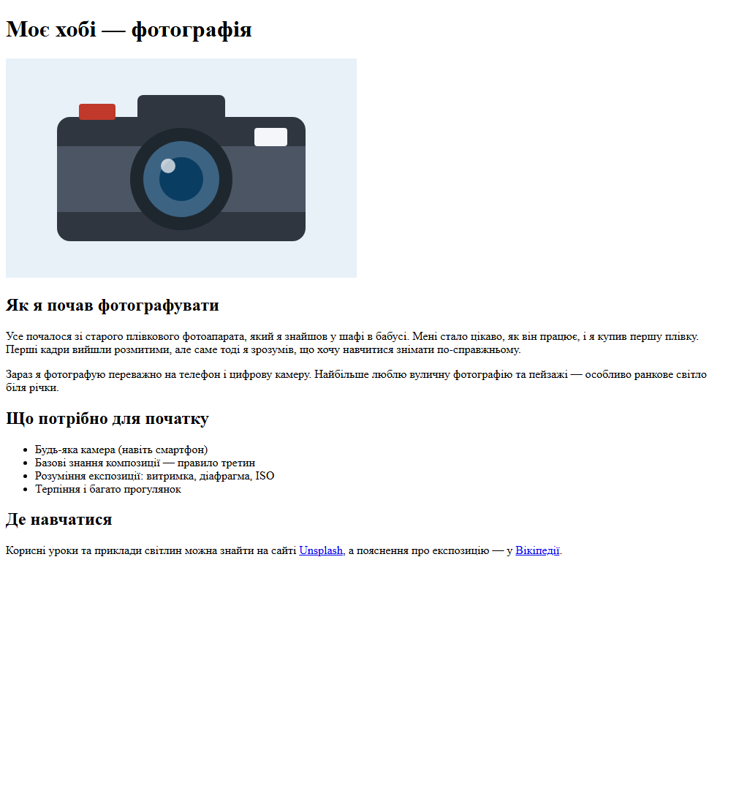
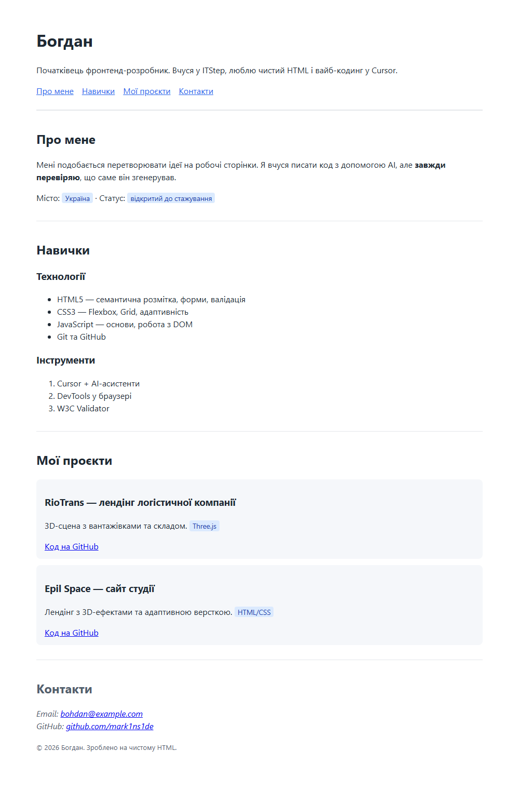
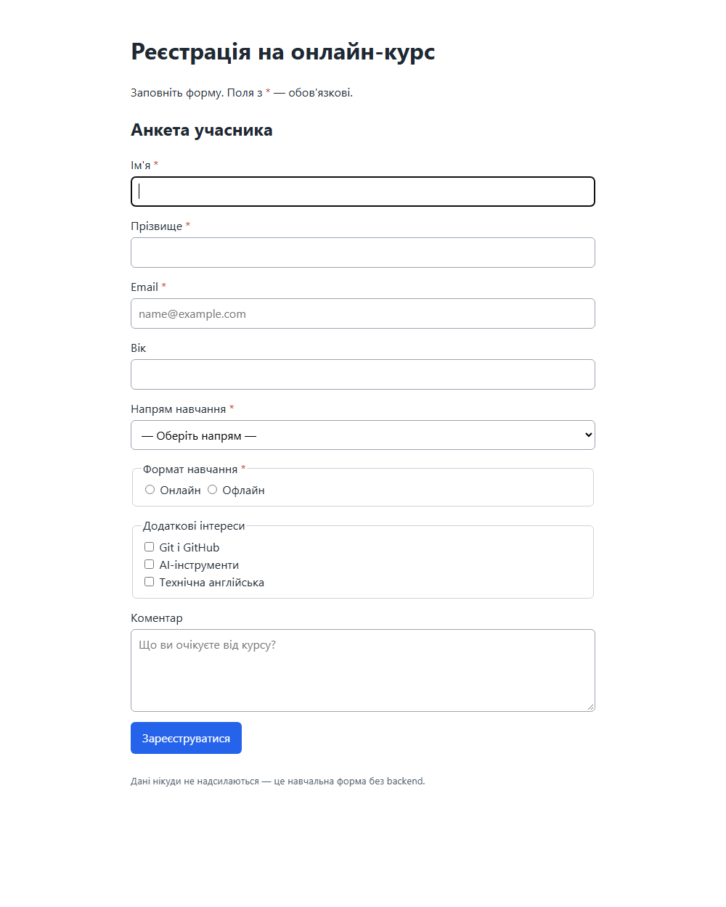
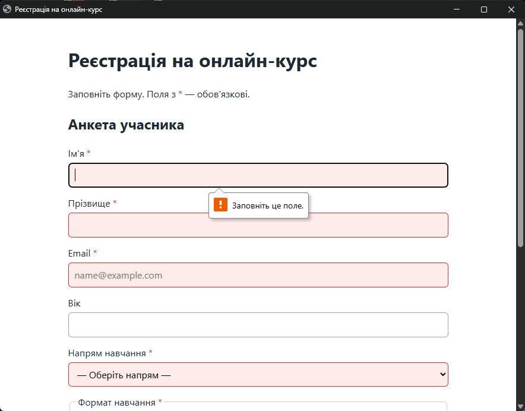

# Модуль 8 — Основи HTML для розуміння згенерованого коду

| Завдання | Файл | Скриншоти |
|---|---|---|
| 1. «Моє хобі» | [task1-hobby/index.html](task1-hobby/index.html) | [task1-hobby.png](screenshots/task1-hobby.png) |
| 2. «Портфоліо розробника» | [task2-portfolio/index.html](task2-portfolio/index.html) | [task2-portfolio.png](screenshots/task2-portfolio.png) |
| 3. «Реєстрація на онлайн-курс» | [task3-registration/index.html](task3-registration/index.html) (виправлена), [form-with-errors.html](task3-registration/form-with-errors.html) (з помилками) | [task3-form.png](screenshots/task3-form.png), [task3-required-check.png](screenshots/task3-required-check.png) |

Усі три основні файли перевірено валідатором `html-validate` — **0 помилок**.

---

## Завдання 1. «Моє хобі» (фотографія)

Сторінка містить `h1`, чотири `h2`, абзаци `p`, маркований список `ul`, зображення `img` з `alt` і зовнішні посилання на Unsplash та Вікіпедію.



**Для чого потрібні теги:**

- **`<head>`** — службова частина документа, яку не видно на сторінці: кодування (`meta charset`), заголовок вкладки (`title`), налаштування для мобільних (`viewport`), підключення стилів.
- **`<body>`** — уся видима частина сторінки: текст, картинки, посилання, форми.
- **`<h1>`** — головний заголовок сторінки (зазвичай один). Пошуковики та скрінрідери використовують його, щоб зрозуміти, про що сторінка.
- **`<a>`** — посилання. Атрибут `href` задає адресу; `target="_blank"` відкриває нову вкладку, а `rel="noopener noreferrer"` робить це безпечно.
- **``** — зображення. `src` — шлях до файлу, `alt` — текстовий опис (його прочитає скрінрідер і його буде видно, якщо картинка не завантажиться). `width`/`height` резервують місце, щоб сторінка не «стрибала» під час завантаження.

---

## Завдання 2. «Портфоліо розробника»

Структура: `header` (ім'я, опис, `nav`) → `main` з трьома `section` (`#about`, `#skills`, `#projects`) → `footer#contacts`. Пункти навігації ведуть на якорі `#id` відповідних розділів.



**Призначення семантичних тегів:**

- **`header`** — шапка сторінки або розділу: назва, логотип, короткий опис.
- **`nav`** — блок основної навігації.
- **`main`** — головний унікальний вміст сторінки (на сторінці лише один).
- **`section`** — тематичний розділ із власним заголовком.
- **`footer`** — підвал: контакти, копірайт. Для контактів використано `address`.
- **`div`** — контейнер без змісту, лише для групування/стилізації (картки проєктів `.project`).
- **`span`** — рядковий контейнер для частини тексту (мітки-теги «Three.js», «у розробці»).

Семантика допомагає скрінрідерам (можна стрибати між `nav`/`main`), пошуковикам і розробникам, які читають код.

**Що перевіряв у згенерованому коді:**

1. `section` — прямі діти `main`, без зайвих обгорток `div`.
2. Кожне посилання в `nav` (`#about`, `#skills`, `#projects`, `#contacts`) має відповідний `id` на сторінці — інакше якір не працює.
3. Рівні заголовків ідуть по черзі: `h1` → `h2` → `h3`, без стрибків на `h4`.
4. `footer` стоїть поза `main`, бо підвал не є основним вмістом.

---

## Завдання 3. «Реєстрація на онлайн-курс»

Поля: ім'я, прізвище (`required`, `minlength="2"`), email (`type="email"`, `required`), вік (`type="number"`, `min="14"`, `max="99"`), напрям (`select` з `required` і порожньою першою опцією), формат (`radio` онлайн/офлайн з однаковим `name`, `required`), інтереси (`checkbox`), коментар (`textarea`, `maxlength="500"`), кнопка `type="submit"`.

Кожне поле має `label` з `for`, що збігається з `id` поля. Групи radio/checkbox обгорнуті в `fieldset` + `legend`. Форма лежить у `main > section`, є `header` і `footer`.



**Перевірка вбудованої валідації** — натиснув «Зареєструватися» з порожньою формою: браузер не відправив дані й показав «Заповніть це поле.» біля першого обов'язкового поля. Незаповнені обов'язкові поля підсвічено червоним через CSS-псевдоклас `:user-invalid`.


### Три навмисні помилки та їх виправлення (без AI)

Файл з помилками — [form-with-errors.html](task3-registration/form-with-errors.html).

**Помилка 1 — неправильна вкладеність: `div` усередині `p`.**

```html
<p>
  <label for="first-name">Ім'я</label>
  <input ... >
  <div>Ім'я має містити щонайменше 2 літери</div>
</p>
```

`p` може містити лише рядковий (phrasing) вміст. Браузер, зустрівши `div`, автоматично закриває `p`, і потім `</p>` виявляється «зайвим». Валідатор: *Stray end tag '&lt;/p&gt;'*.
**Виправлення:** замінив `p` на `div class="field"` (а підказку можна зробити `span` або атрибутом `minlength`).

**Помилка 2 — `label` не пов'язаний із полем.**

```html
<label for="email">Email</label>
<input type="email" id="mail" name="email" required>
```

`for="email"`, а `id="mail"` — клік по підпису не ставить курсор у поле, скрінрідер не озвучує підпис. W3C Validator: *The value of the for attribute of the label element must be the ID of a non-hidden form control*.
**Виправлення:** `id="email"`, щоб `for` і `id` збігалися.

**Помилка 3 — дублікат `id`.**

```html
<input type="radio" id="format" name="format" value="online">
<label for="format">Онлайн</label>
<input type="radio" id="format" name="format" value="offline">
<label for="format">Офлайн</label>
```

`id` має бути унікальним на сторінці. Через дубль обидва підписи вказують на першу кнопку — клік по «Офлайн» вибирає «Онлайн». Валідатор: *Duplicate ID "format"*.
**Виправлення:** `id="format-online"` і `id="format-offline"`; `name="format"` лишається спільним, щоб кнопки були однією групою.

### Як перевіряв

1. Відкрив файл з помилками у браузері й DevTools (Elements) — побачив, що `div` «виліз» за межі `p`.
2. Клікнув по підписах «Email» і «Офлайн» — поведінка неправильна.
3. Прогнав файл через [W3C Validator](https://validator.w3.org/#validate_by_upload) / `html-validate`.
4. Виправив вручну і повторно перевірив — 0 помилок.
