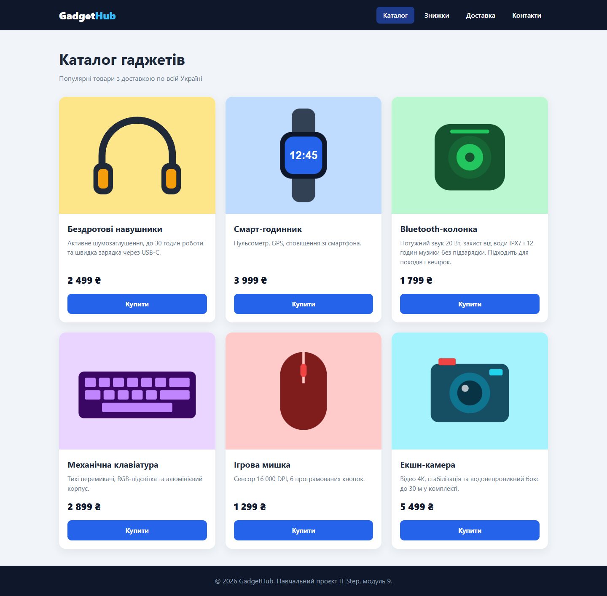
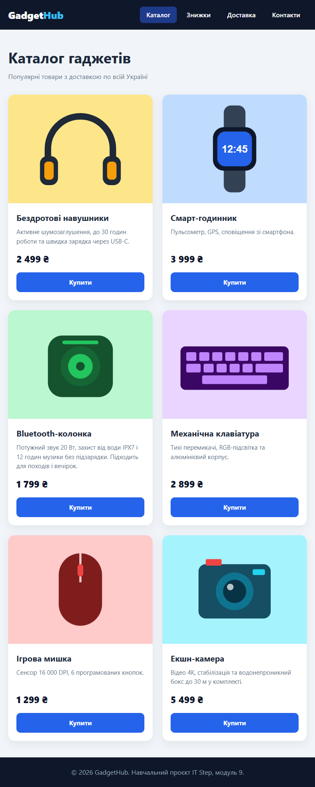

# Модуль 9 — CSS, Flexbox, Grid та адаптивність

| Завдання | Файли | Скриншоти |
|---|---|---|
| 1. Картка профілю | [index.html](task1-profile-card/index.html), [style.css](task1-profile-card/style.css) | [комп'ютер](screenshots/task1-profile-card.png) |
| 2. Адаптивний каталог | [index.html](task2-catalog/index.html), [style.css](task2-catalog/style.css) | [1440](screenshots/task2-desktop-1440.png), [768](screenshots/task2-tablet-768.png), [375](screenshots/task2-mobile-375.png), [375 + меню](screenshots/task2-mobile-375-menu.png) |

JavaScript, Tailwind і backend не використовуються — лише HTML і CSS. Обидва HTML-файли перевірено `html-validate` — **0 помилок**.

---

## Завдання 1. Картка профілю

- **Окремий CSS** — `<link rel="stylesheet" href="style.css">`.
- **Кольори, шрифти, розміри** — `font-family`, `font-size`, `font-weight`, `color` для імені, професії й опису.
- **margin / padding** — `padding` всередині картки й кнопки, `margin-bottom` між елементами.
- **border-radius** — заокруглена картка (`20px`), круглий аватар (`50%`), кнопка-«пігулка» (`999px`).
- **box-shadow** — тінь у картки та кнопки.
- **Центрування** — на `body`: `display: flex; justify-content: center; align-items: center; min-height: 100vh;`.
- **:hover** — кнопка темнішає (`#2563eb` → `#1d4ed8`) і трохи піднімається; `transition` робить зміну плавною.

---

## Завдання 2. Адаптивний каталог товарів

| 1440 px — 3 картки | 768 px — 2 картки | 375 px — 1 картка |
|---|---|---|
|  |  |  |

Мобільне меню відкрите:

**Як це працює:**

- **CSS Grid** — `.catalog { display: grid; grid-template-columns: repeat(3, 1fr); gap: 24px; }`.
- **Медіазапити** — до `1024px` → `repeat(2, 1fr)` (планшет), до `640px` → `1fr` (телефон).
- **Flexbox у картці** — `.product` і `.product__body` мають `display: flex; flex-direction: column;`, тіло картки `flex-grow: 1`.
- **Кнопки внизу** — у ціни `margin-top: auto`: вона забирає весь вільний простір над собою, тож ціна й «Купити» притискаються до низу навіть коли опис коротший (видно на «Смарт-годиннику» і «Мишці»).
- **Зображення не виходять за межі** — `width: 100%; height: auto; object-fit: cover;` + `overflow: hidden` у картки (щоб картинка не «вилазила» за заокруглені кути).
- **Адаптивне меню без JS** — на телефоні пункти меню ховаються (`display: none`), з'являється бургер. Бургер — це `<label>` для прихованого `<input type="checkbox">`; при кліку чекбокс вмикається, і правило `.nav-toggle:checked ~ .nav { display: block; }` показує меню. Три смужки зроблені з `span` і псевдоелементів `::before`/`::after`, а в відкритому стані повертаються в хрестик через `transform: rotate(±45deg)`.

**Перевірка ширин:** 375, 768 і 1440 px — горизонтальної прокрутки немає (`scrollWidth` = ширині екрана), жодна картинка не ширша за свою картку.
